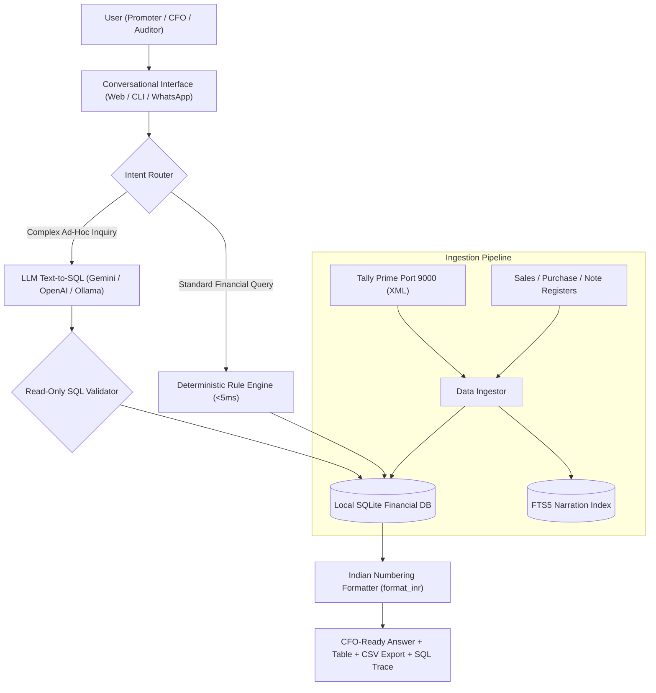

# LedgerGPT 📊
> **The Zero-Hallucination Conversational Finance & Forensic Audit Engine for ERP & Tally Prime.**

[](LICENSE)
[](https://www.python.org/downloads/)
[](docs/architecture.md)
[](docs/architecture.md)
[](https://tallysolutions.com/)

---

## ⚡ Why LedgerGPT?

Standard Large Language Models (ChatGPT, Claude, etc.) **hallucinate numbers, fail at arithmetic, and cannot be trusted with statutory accounts or tax reporting**. Furthermore, enterprise CFOs cannot transmit confidential customer ledgers or bank statements to public cloud APIs.

**LedgerGPT** is built with a **Deterministic-First AI Architecture**:
1. **100% Accurate:** Translates business questions into verified SQLite `SELECT` queries executed against genuine local databases. Zero math hallucinations.
2. **Instant Microsecond Performance:** Common financial queries (totals, aging, top clients, debit/credit notes) execute via deterministic pattern matching in **under 5 milliseconds**.
3. **Deep Narration Intelligence:** Indexes every voucher narration using **SQLite FTS5 Full-Text Search**, unlocking forensic audit insights that standard dashboards completely ignore.
4. **100% On-Premise Privacy:** Can operate in pure **Rule-Only / Local Mode** with zero external API calls, keeping financial data completely private.
5. **Audited & Traceable:** Every answer displays the exact underlying SQL query, execution time, formatted breakdown table, and a 1-click CSV download.

---

## 🏗️ Architecture



---

## 🚀 Quickstart (Under 60 Seconds)

### 1. Clone & Install
```bash
git clone https://github.com/datawizibility/LedgerGPT.git
cd LedgerGPT
pip install -r requirements.txt
```

### 2. Launch Interactive Web Cockpit
```bash
python run_web.py
```
Open **`http://127.0.0.1:5000`** in any web browser. 

*(If starting for the first time, LedgerGPT automatically initializes and indexes the preloaded 50,102-voucher audited Genesis sample dataset!)*

### 3. Or Run Directly from Terminal CLI
```bash
# Interactive Chat Loop
python cli.py

# Single-Shot Query
python cli.py -q "Top 5 clients by revenue"

# Portfolio KPI Summary
python cli.py --kpis

# Run Forensic Audit Suite
python cli.py --forensic
```

---

## 💬 Sample Inquiries LedgerGPT Answers

### 📈 Sales & Revenue
- *"What was our total sales in FY 2017-18?"*
- *"Top 10 clients by gross billed volume"*
- *"Show sales trend by quarter"*
- *"How much did we bill Bennett Coleman in Q2?"*

### 🛒 Purchases & Vendor Expenses
- *"What are our total purchases across the 2 years?"*
- *"Top 10 vendors by net expense amount"*
- *"Show all bills received from Akhbar - E -Mashriq"*
- *"What did we spend on 998363-Print Media Purchase?"*

### 📑 Debit & Credit Notes
- *"Show all Debit Notes issued for vendor cancellations"*
- *"What is our total rate difference deduction across all suppliers?"*
- *"List all Credit Notes issued to West Bengal State Electricity"*

### 🛡️ Forensic & Anomaly Inquiries
- *"Search narrations for words like cancel, dispute, settlement, or difference"*
- *"Find all round-sum payments above ₹1,00,000"*
- *"Show vouchers dated or entered on weekends (Saturday / Sunday)"*
- *"Detect potential duplicate bills with matching vendor reference numbers"*

---

## 🛡️ Forensic Audit & Anomaly Detection Suite

LedgerGPT includes an automated **Forensic Audit Engine** (`ForensicScanner`):

1. **Benford's Law First-Digit Distribution:** Compares empirical first-digit frequencies ($1..9$) against the logarithmic logarithmic curve ($P(d) = \log_{10}(1 + 1/d)$) to spot fabricated invoices.
2. **Suspicious Narration Hunter:** Sub-millisecond FTS5 search across narrations for kickback, dispute, or non-business indicators (*"cash", "round off", "personal", "cancel", "settlement"*).
3. **Round-Sum Transaction Detector:** Flags round-sum payments ($\ge ₹1,00,000$) that are exact multiples of ₹10,000.
4. **Weekend / Holiday Voucher Scanner:** Identifies transactions dated on Saturdays and Sundays.
5. **Duplicate Bill / Reference Matcher:** Flags identical party and invoice numbers appearing multiple times.

---

## 🔌 Connecting Your Own Data

### Method 1: CSV / Excel Registers
Simply place your CSV or Excel files in `sample_data/` or use the CLI:
```bash
python cli.py --ingest /path/to/my_sales_register.csv
```
LedgerGPT features **intelligent fuzzy column mapping** that auto-detects column variants like `Invoice Date`, `Bill Date`, `Client Name`, `Gross Billed Amount`, `Vendor Bill Ref`, etc.

### Method 2: Live Tally Prime XML Sync (Port 9000)
Ensure Tally Prime is open with ODBC / XML enabled on port 9000. LedgerGPT connects directly using its live report envelope.

---

## 🌐 REST API Reference

| Endpoint | Method | Payload / Params | Description |
| :--- | :---: | :--- | :--- |
| `/api/chat` | `POST` | `{"query": "Top 5 clients"}` | Execute natural language query and receive verified answer, table data, and SQL |
| `/api/kpis` | `GET` | *None* | Get consolidated financial KPIs (Total sales, purchases, notes, vouchers) |
| `/api/forensic` | `GET` | *None* | Run the complete 5-part forensic audit anomaly scan |
| `/api/export` | `POST` | `{"data": [...], "columns": [...]}` | Stream query results as a downloadable UTF-8 BOM CSV |

---

## 💼 Commercial & Enterprise Use Cases

1. **Group CFOs & Finance Controllers:** Instant answers during board meetings and lender discussions without waiting for the accounts team.
2. **Chartered Accountants & Statutory Auditors:** 1-click forensic analysis and sampling before signing off on financial statements.
3. **Forensic Investigators & Bank Stock Auditors:** Detect round-tripping, smurfing, and suspicious narration adjustments in NPA / IBC accounts.
4. **SME Business Owners:** Ask questions in plain English or Hindi and get instant, verified figures with zero Tally keyboard navigation.

---

## 📄 License
Released under the [MIT License](LICENSE). Copyright (c) 2026 Datawizibility (Amit Rathi).
