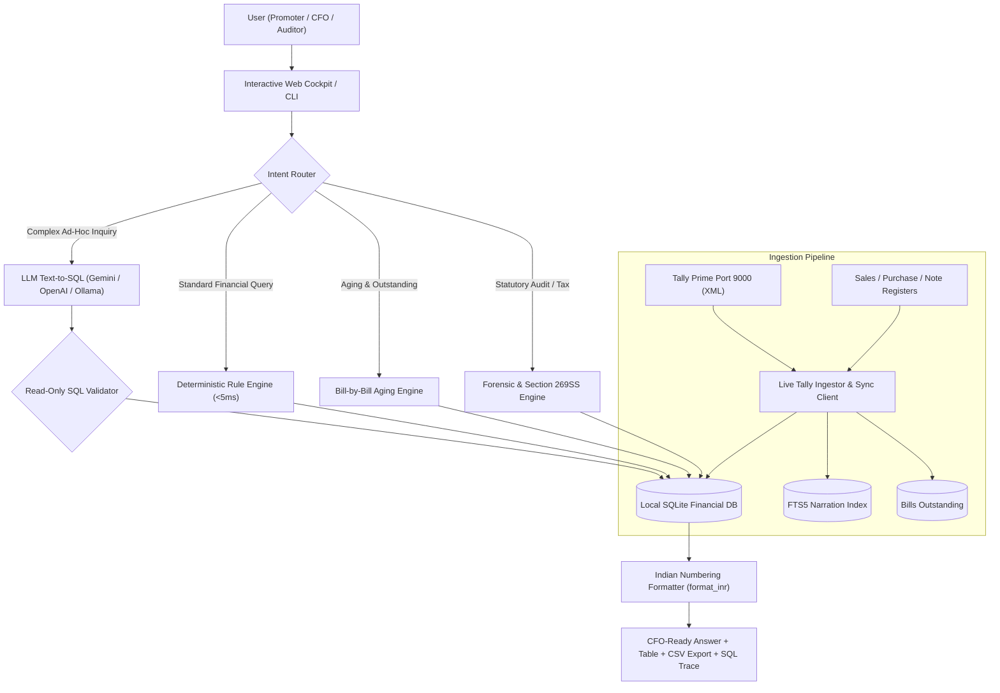

# LedgerGPT 📊
> **The Zero-Hallucination Conversational Finance & Forensic Audit Engine for ERP & Tally Prime.**

[](LICENSE)
[](https://www.python.org/downloads/)
[](docs/architecture.md)
[](docs/architecture.md)
[](https://tallysolutions.com/)
[](USER_MANUAL.md)
[](HOW_TO_GUIDE.md)

---

## ⚡ Why LedgerGPT?

Standard Large Language Models (ChatGPT, Claude, etc.) **hallucinate numbers, fail at arithmetic, and cannot be trusted with statutory accounts or tax reporting**. Furthermore, enterprise CFOs cannot transmit confidential customer ledgers or bank statements to public cloud APIs.

**LedgerGPT** is built with a **Deterministic-First AI Architecture**:
1. **100% Accurate:** Translates business questions into verified SQLite `SELECT` queries executed against genuine local databases. Zero math hallucinations.
2. **Instant Microsecond Performance:** Common financial queries (totals, aging, top clients, debit/credit notes, party statements) execute via deterministic pattern matching in **under 5 milliseconds**.
3. **Bill-by-Bill Debtor & Creditor Aging Intelligence:** Extracts live `BillsOutstanding` tracking from Tally Prime into 4 institutional buckets (`0-30`, `31-60`, `61-90`, `90+` days) with risk ratings and critical overdue alerts.
4. **Deep Narration Intelligence:** Indexes every voucher narration using **SQLite FTS5 Full-Text Search**, unlocking forensic audit insights that standard dashboards completely ignore.
5. **Tax Audit & Statutory Forensics (Form 3CD Clause 31):** Automated scanners for Section 269SS/269T cash loan violations ($\ge$ ₹20,000) and daily negative cash balance reconstitution.
6. **100% On-Premise Privacy:** Can operate in pure **Rule-Only / Local Mode** with zero external API calls, keeping financial data completely private.
7. **Audited & Traceable:** Every answer displays the exact underlying SQL query, execution time, formatted breakdown table, and a 1-click CSV download.

---

## 🏗️ Architecture



---

## 📚 Documentation & Manuals

* 📘 **[Complete User Manual](USER_MANUAL.md)**: Operating manual for CFOs, controllers, and statutory auditors.
* 🛠️ **[How-To Guide & Recipes](HOW_TO_GUIDE.md)**: Practical recipes for live Tally sync, CSV ingestion, Section 269SS checks, and CLI automation.
* 🏛️ **[Technical Architecture](docs/architecture.md)**: Deep dive into the deterministic-first query pipeline and database schemas.
* 📝 **[Change Log](log_changes.md)**: Version history and feature releases.

---

## 🚀 Quickstart (Under 60 Seconds)

### 1. Clone & Install
```bash
git clone https://github.com/datawizibility/LedgerGPT.git
cd LedgerGPT
pip install -r requirements.txt
```

### 2. Launch Interactive Web Cockpit
```bash
python run_web.py
```
Open **`http://127.0.0.1:5000`** in any web browser. 

*(If starting for the first time, LedgerGPT automatically initializes and indexes the preloaded 50,102-voucher audited Genesis sample dataset!)*

### 3. Or Run Directly from Terminal CLI
```bash
# Interactive Chat Loop
python cli.py

# Single-Shot Query
python cli.py -q "Show creditors aging"

# Portfolio KPI Summary
python cli.py --kpis

# Run Complete Forensic Audit Suite
python cli.py --forensic
```

---

## 🎯 Key Features

### 1. Bill-by-Bill Debtor & Creditor Aging Intelligence Cockpit
* Direct live XML extraction from Tally's `BillsOutstanding` collection.
* Automated classification into 4 risk tiers:
  * **0 - 30 Days** (*Low Risk*)
  * **31 - 60 Days** (*Moderate Risk*)
  * **61 - 90 Days** (*Elevated Risk*)
  * **90+ Days** (*Critical Risk*)
* Pinpoints chronic overdue balances with exact overdue days, invoice numbers, and party names.
* Seamless dynamic fallback engine for offline or untagged accounts.

### 2. Dynamic Project Site & Fiscal Year Filtering
* Instant multi-site support: Extracts distinct project sites (Cost Centres) dynamically.
* Cascades selected Cost Centre / Site and Fiscal Year across KPIs, monthly trends, vendor rankings, aging buckets, and transaction grids.

### 3. 1-Click CFO MIS Board Pack
* Dedicated header button generating a comprehensive, pre-formatted CSV board digest:
  1. Executive Summary & Working Capital Metrics
  2. Cash & Bank Liquidity Breakdown
  3. Receivables & Payables Aging Overview
  4. Top 10 Debtors (Revenue) & Top 10 Creditors (Procurement)
  5. Critical Overdue Invoices (> 90 Days)

### 4. Forensic Audit & Statutory Scanner (CA J Ramajayam Benchmark)
* **Section 269SS & 269T Violations (Form 3CD Clause 31)**: Detects cash loans, deposits, and repayments $\ge$ ₹ 20,000 across loan and advance accounts.
* **Daily Negative Cash Balance Scanner**: Reconstructs day-by-day cash ledger running balance, flagging dates where cash dipped below ₹ 0.00.
* **Benford's Law First-Digit Analysis**: Spots fabricated or artificial invoice amounts.
* **Suspicious Narration Hunter**: Fast FTS5 search for kickback, dispute, or non-business keywords.
* **Round-Sum Transaction Detector**: Identifies high-value round payments ($\ge$ ₹ 1,00,000).
* **Weekend / Holiday Scanner**: Highlights vouchers booked outside regular business operations.
* **Duplicate Bill / Reference Matcher**: Flags matching party and reference numbers.

---

## 💬 Sample Inquiries LedgerGPT Answers

### 📊 Aging & Working Capital
- *"Show creditors aging"*
- *"Show debtors aging"*
- *"Bills outstanding summary"*

### ⚖️ Statutory & Compliance
- *"Scan Section 269SS and 269T cash loan violations"*
- *"Form 3CD Clause 31"*
- *"Negative cash balance"*

### 👤 Party Statements & Cash Flows
- *"Ajay Kumar ledger"*
- *"Show Bennett Coleman account statement"*
- *"Show cash inflow and outflow"*

### 📈 Sales & Revenue
- *"What was our total sales in FY 2024-25?"*
- *"Top 10 clients by gross billed volume"*
- *"Show sales trend by quarter"*

### 🛒 Purchases & Expenses
- *"What are our total purchases across the 2 years?"*
- *"Top 10 vendors by net expense amount"*
- *"Show all bills received from Arun Automobiles"*

### 📑 Debit & Credit Notes
- *"Show all Debit Notes issued for vendor cancellations"*
- *"What is our total rate difference deduction across all suppliers?"*

---

## 🌐 REST API Reference

| Endpoint | Method | Params / Payload | Description |
| :--- | :---: | :--- | :--- |
| `/api/chat` | `POST` | `{"query": "Show creditors aging"}` | Execute natural language query and receive verified answer, table data, and SQL |
| `/api/dashboard/aging` | `GET` | `?nature=all&cost_centre=...&fy=...` | Get 4-bucket debtor & creditor aging breakdown and overdue risk classification |
| `/api/dashboard/cfo-mis-pack` | `GET` | `?cost_centre=...&fy=...` | Download 1-click formatted CSV board digest |
| `/api/dashboard/cost-centres` | `GET` | *None* | List all project sites / cost centres extracted from voucher postings |
| `/api/dashboard/periods` | `GET` | *None* | List all distinct Fiscal Years available in the database |
| `/api/dashboard/summary` | `GET` | `?cost_centre=...&fy=...` | Get top-level executive KPIs (Sales, Expenses, Notes, Vouchers) |
| `/api/dashboard/monthly-trend` | `GET` | `?cost_centre=...&fy=...` | Get monthly revenue vs expense time-series for Chart.js |
| `/api/dashboard/rankings` | `GET` | `?top_n=10&cost_centre=...&fy=...` | Get top clients and top vendors |
| `/api/dashboard/vouchers-grid` | `GET` | `?page=1&type=...&search=...` | Paginated voucher ledger with full search and filters |
| `/api/forensic` | `GET` | *None* | Run the complete 7-part forensic audit and statutory compliance scan |
| `/api/tally-companies` | `GET` | *None* | List all companies currently open in Tally Prime on port 9000 |
| `/api/tally-sync` | `POST` | `{"company_name": "..."}` | Stream live voucher and bill extraction from active Tally company |

---

## 📄 License
Released under the [MIT License](LICENSE). Copyright (c) 2026 Datawizibility (Amit Rathi).
