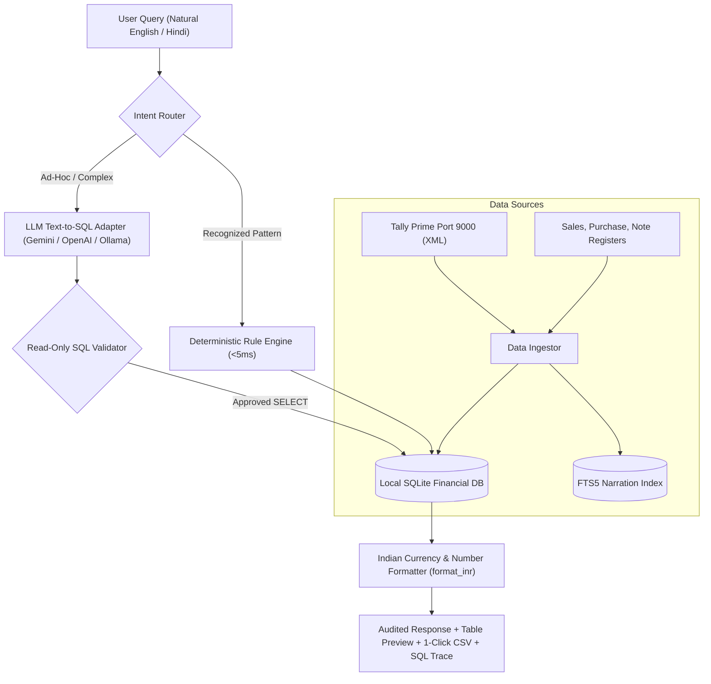

# LedgerGPT Architecture & Engineering Design

## 1. The Core Engineering Challenge: Zero-Hallucination Finance
Generic LLMs (ChatGPT, Claude, etc.) generate plausible text, but they hallucinate numbers, make arithmetic rounding errors, and cannot be trusted with statutory accounts or tax reporting. Furthermore, Indian enterprise CFOs cannot transmit confidential customer ledgers or bank statements to public cloud APIs.

**LedgerGPT** resolves this via a **Deterministic-First AI Architecture**:
1. Natural language inquiries are routed through deterministic regex/pattern rules first (<5ms execution).
2. Complex queries fall back to an LLM *only* to generate an audited SQLite `SELECT` query.
3. The query executes locally against genuine ERP/Tally data.
4. The output is formatted with Indian numbering (`₹ #,##0.00` / Lakhs / Crores) with a 100% auditable SQL trace and a 1-click CSV download of underlying vouchers.

---

## 2. Full-Text Search (FTS5) for Instant Narration Auditing
In standard ERP systems, transaction narrations are treated as unindexed text fields. LedgerGPT maintains an SQLite **FTS5 Virtual Table** (`vouchers_fts`) linking directly to `vouchers`. 

This enables instant (<1ms) searches across hundreds of thousands of voucher narrations for forensic keywords such as:
- `"cancellation"` / `"cancel"`
- `"settlement"` / `"dispute"`
- `"rate difference"`
- `"director"` / `"personal"`
- `"penalty"` / `"interest"`

---

## 3. Forensic Anomaly Engine
LedgerGPT embeds an automated forensic scanning module (`ForensicScanner`):
1. **Benford's Law Analysis**: Calculates the empirical distribution of first digits ($d \in [1..9]$) and flags deviations $>5\%$ from $\log_{10}(1 + 1/d)$.
2. **Round-Sum Transactions**: Flags large payments (e.g. $\ge ₹1,00,000$) that are exact multiples of ₹10,000.
3. **Weekend & Holiday Entries**: Detects vouchers dated or posted on Saturdays and Sundays.
4. **Duplicate Bill Detection**: Groups by party name and reference number to isolate duplicate billings.
